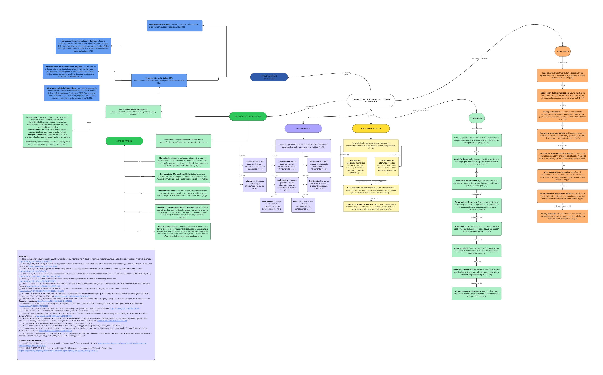

# FORM-MC-01

## Ecosistema de Sistemas Distribuidos

Mapa conceptual colaborativo · Aplicaciones Distribuidas · Caso de estudio: Spotify

## Descripción

Este repositorio contiene el mapa conceptual digital sobre el ecosistema de sistemas distribuidos, elaborado colaborativamente como actividad formativa preparatoria para la PE-U1 y la EXP-1.

El mapa presenta definiciones breves, relaciones explícitas entre conceptos y referencias bibliográficas recientes y verificables. Como eje de aplicación, el equipo analiza Spotify como sistema distribuido real para sustentar el trabajo de la EXP-1.

## Vista previa del mapa conceptual




## Objetivo

Organizar visualmente los principales componentes de los sistemas distribuidos, mostrando sus características, clasificaciones, mecanismos de comunicación y relaciones fundamentales, y vincularlos con un caso real de estudio.

## Contenido del mapa

El mapa conceptual desarrolla los siguientes temas:

- Concepto y características de los sistemas distribuidos.
- Tipos de sistemas distribuidos.
- Computación en la nube, CDN y edge.
- Middleware.
- Modelos de comunicación: RPC y mensajería.
- Transparencia de acceso, ubicación, concurrencia, migración, reubicación, persistencia y fallos, entre otras.
- Tolerancia a fallos.
- Replicación y su relación con la transparencia y la tolerancia a fallos.
- Teorema CAP (consistencia, disponibilidad y tolerancia a particiones).
- Modelos de consistencia.
- Spotify como sistema distribuido real.

## Caso de estudio: Spotify

Spotify se selecciona como sistema distribuido real para la EXP-1 por su arquitectura basada en microservicios, su dependencia de brokers de mensajes para el flujo de eventos y su gestión de consistencia y disponibilidad en escala global.

Los informes oficiales de incidentes publicados por Spotify Engineering permiten analizar decisiones prácticas frente al teorema CAP, la tolerancia a fallos y la recuperación del servicio. Este análisis se complementa con la bibliografía académica del repositorio.

## Recursos del proyecto

| Recurso | Acceso |
|---|---|
| Tablero colaborativo en Miro | [Abrir mapa conceptual](https://miro.com/app/board/uXjVETSJs2A=/?share_link_id=906461992918) |
| Mapa conceptual en PNG | [Visualizar imagen](doc/SPOTIFY.jpg) |
| Mapa conceptual en PDF | [Visualizar PDF](doc/SPOTIFY.pdf) |
| Referencias bibliográficas | [Consultar archivo .bib](bibliografia_sistemas_distribuidos.bib) |
| Documentos del proyecto | [Abrir carpeta doc](https://github.com/jcedenoi4/FORM-MC-01-Mapa-Conceptual-Colaborativo/tree/main/doc) |


## Integrantes

| N.º | Estudiante |
|---|---|
| 1 | CEDEÑO INTRIAGO JILMAR JESUS |
| 2 | MACIAS VASQUEZ CESAR ABRAHAN |
| 3 | SANCHEZ VERA DARWIN JOEL |

## Datos académicos

| Campo | Información |
|---|---|
| Universidad | Universidad Técnica Estatal de Quevedo |
| Carrera | Ingeniería en Software |
| Asignatura | Aplicaciones Distribuidas |
| Actividad | FORM-MC-01 |
| Producto | Mapa conceptual del ecosistema de sistemas distribuidos |
| Modalidad | Grupal |
| Carácter | Formativa |
| Docente | Guerrero Ulloa Gleiston Ciceron |
| Periodo académico | 2026–2027 |

## Organización del repositorio

```
FORM-MC-01-Mapa-Conceptual-Colaborativo/
├── doc/
│   ├── SPOTIFY.pdf
│   └── SPOTIFY.jpg
├── bibliografia_sistemas_distribuidos.bib
└── README.md
```

- `doc/SPOTIFY.jpg`: vista previa del mapa conceptual.
- `doc/SPOTIFY.pdf`: versión final exportada del mapa.
- `bibliografia_sistemas_distribuidos.bib`: referencias utilizadas en formato BibTeX.
- `README.md`: documentación general de la actividad.

## Criterios aplicados

- Definiciones de máximo 20 palabras.
- Relaciones explícitas entre los conceptos.
- Referencias académicas verificables.
- Fuentes publicadas durante los últimos cinco años.
- Elaboración colaborativa mediante Miro.
- Exportación del mapa conceptual en PDF.
- Conservación de las referencias en formato BibTeX.
- Publicación de los archivos en un repositorio de GitHub.


## Referencias del mapa

Las fuentes utilizadas para sustentar los conceptos del mapa se encuentran reunidas en:

[referencias bibliográficas](bibliografia_sistemas_distribuidos.bib)

## Tablero colaborativo en Miro

El mapa conceptual puede consultarse en su versión interactiva mediante el siguiente enlace:

[Abrir mapa conceptual en Miro](https://miro.com/app/board/uXjVETSJs2A=/?share_link_id=906461992918)

El tablero tiene permisos de visualización para facilitar la revisión del mapa y del trabajo colaborativo.

---

Universidad Técnica Estatal de Quevedo

Ingeniería en Software · Aplicaciones Distribuidas

Actividad desarrollada por:

Cedeño Intriago Jilmar Jesus · Macias Vasquez Cesar Abrahan · Sanchez Vera Darwin Joel
